# CUVOTO System Architecture

## Table of Contents

- [1. System Overview](#1-system-overview)
- [2. High-Level Architecture](#2-high-level-architecture)
- [3. System Architecture Diagram](#3-system-architecture-diagram)
- [4. Hardware Layer](#4-hardware-layer)
  - [4.1 Tank Unit (Sensor Node)](#41-tank-unit-sensor-node)
  - [4.2 Pump Unit (Controller Node)](#42-pump-unit-controller-node)
  - [4.3 Pump Simulator](#43-pump-simulator)
- [5. Communication Layer](#5-communication-layer)
  - [5.1 ESP-NOW (Device-to-Device)](#51-esp-now-device-to-device)
  - [5.2 MQTT (Device-to-Cloud)](#52-mqtt-device-to-cloud)
  - [5.3 MQTT Topic Map](#53-mqtt-topic-map)
- [6. Cloud & Backend Layer](#6-cloud--backend-layer)
  - [6.1 Supabase](#61-supabase)
  - [6.2 HiveMQ Cloud](#62-hivemq-cloud)
- [7. Frontend / Web Application](#7-frontend--web-application)
  - [7.1 Technology Stack](#71-technology-stack)
  - [7.2 Application Routes](#72-application-routes)
  - [7.3 Component Architecture](#73-component-architecture)
- [8. Data Flow Diagrams](#8-data-flow-diagrams)
  - [8.1 Sensor Data Flow](#81-sensor-data-flow)
  - [8.2 Motor Command Flow](#82-motor-command-flow)
  - [8.3 User Authentication Flow](#83-user-authentication-flow)
- [9. Database Schema](#9-database-schema)
- [10. Deployment Architecture](#10-deployment-architecture)
- [11. Security Considerations](#11-security-considerations)
- [12. Component Interaction Diagram](#12-component-interaction-diagram)
- [13. State Machine Diagrams](#13-state-machine-diagrams)

---

## 1. System Overview

**CUVOTO** (by CUVOTO Private Limited, Bangalore, India) is a full-stack IoT water tank management system. It provides real-time monitoring of water levels, temperature, and salinity (TDS), along with remote and automatic pump/motor control.

The system spans three layers:

| Layer | Technology | Purpose |
|-------|-----------|---------|
| **Hardware** | ESP32 + PlatformIO (C++) | Sensors, pump relay, ESP-NOW communication |
| **Cloud** | HiveMQ (MQTT) + Supabase (Auth/DB) | Real-time messaging, user management |
| **Frontend** | React + TypeScript + Vite | Web/mobile dashboard for monitoring & control |

---

## 2. High-Level Architecture

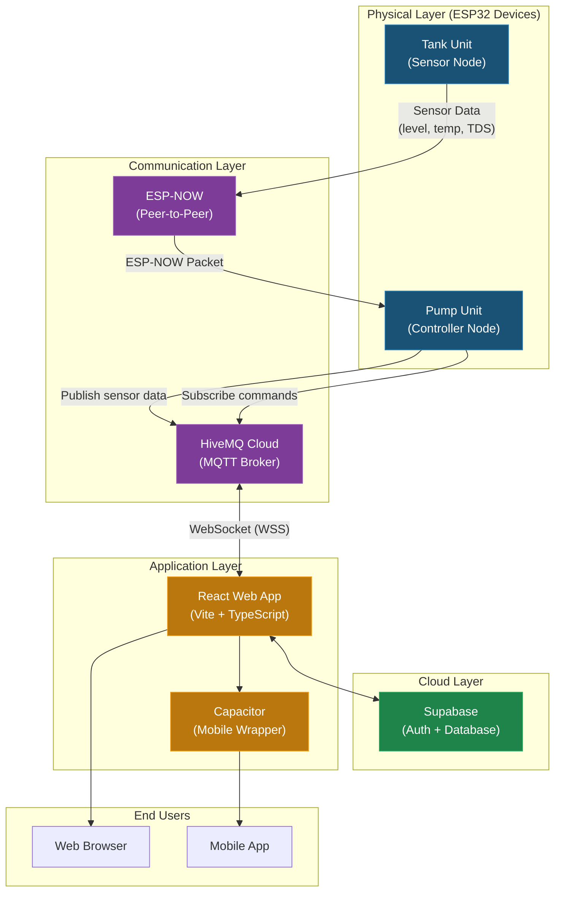

---

## 3. System Architecture Diagram

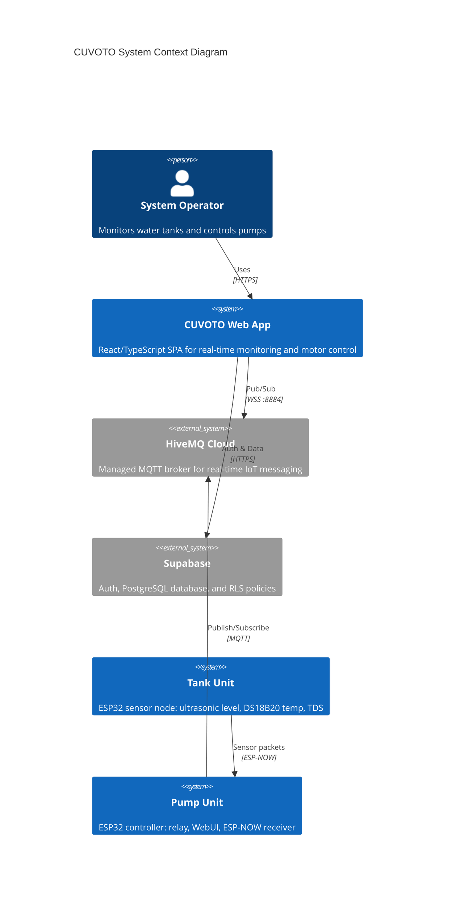

---

## 4. Hardware Layer

### 4.1 Tank Unit (Sensor Node)

The Tank Unit is an ESP32 microcontroller positioned at the water tank. It reads sensor data and transmits it wirelessly to the Pump Unit.

**Sensors:**

| Sensor | Pin | Purpose |
|--------|-----|---------|
| HC-SR04 Ultrasonic (TRIG) | GPIO 5 | Water level measurement |
| HC-SR04 Ultrasonic (ECHO) | GPIO 18 | Water level measurement |
| DS18B20 Temperature | GPIO 4 | Water temperature (Celsius) |
| TDS Sensor (Analog) | GPIO 34 | Total Dissolved Solids (ppm) |

**Key Parameters:**

| Parameter | Value |
|-----------|-------|
| Tank Depth | 120 cm |
| Full Level (sensor-to-water) | 29.0 cm |
| Empty Level (sensor-to-water) | 155.0 cm |
| Filter Alpha (EMA) | 0.2 |
| Send Interval | 10,000 ms (10 sec) |
| Ultrasonic Samples | 7 (median filtered) |

**Data Packet Structure:**

```c
struct TankPacket {
    uint8_t  level;       // 0-100 (percentage)
    float    temperature; // Celsius
    int      tds;         // ppm (parts per million)
    uint32_t timestamp;   // millis()
};
```

### 4.2 Pump Unit (Controller Node)

The Pump Unit is an ESP32 that receives sensor data from the Tank Unit, makes pump control decisions, and serves a local WebUI for configuration.

**Hardware Pins:**

| Component | Pin | Purpose |
|-----------|-----|---------|
| Relay | GPIO 23 | Pump motor on/off |
| Status LED | GPIO 2 | Pump running indicator |
| Manual ON Button | GPIO 32 | Physical override (on) |
| Manual OFF Button | GPIO 33 | Physical override (off) |

**Operating Modes:**

| Mode | Behavior |
|------|----------|
| `AUTO` (0) | Pump ON when level <= low limit, OFF when level >= high limit |
| `MANUAL` (1) | User-controlled start/stop via WebUI or app |
| `TIMER` (2) | Pump ON during configured time window (supports overnight) |

**Safety Features:**

| Feature | Threshold |
|---------|-----------|
| Max Run Time | 3,600 sec (1 hour) |
| No-Data Timeout | 10,000 ms (10 sec) |
| Boot Behavior | Force pump OFF |

**Default Thresholds:**

| Setting | Default |
|---------|---------|
| Low Limit (pump ON) | 25% |
| High Limit (pump OFF) | 80% |
| Timer Start | 06:00 |
| Timer Stop | 07:00 |

**Persistence:** All settings are stored in ESP32 NVS (Non-Volatile Storage) via the `StateStore` class using the `Preferences` library. Settings survive power cycles.

### 4.3 Pump Simulator

A development/testing tool that simulates water level fluctuations and pump behavior without physical hardware. Runs on ESP32 with a WebUI for testing the control logic.

---

## 5. Communication Layer

### 5.1 ESP-NOW (Device-to-Device)

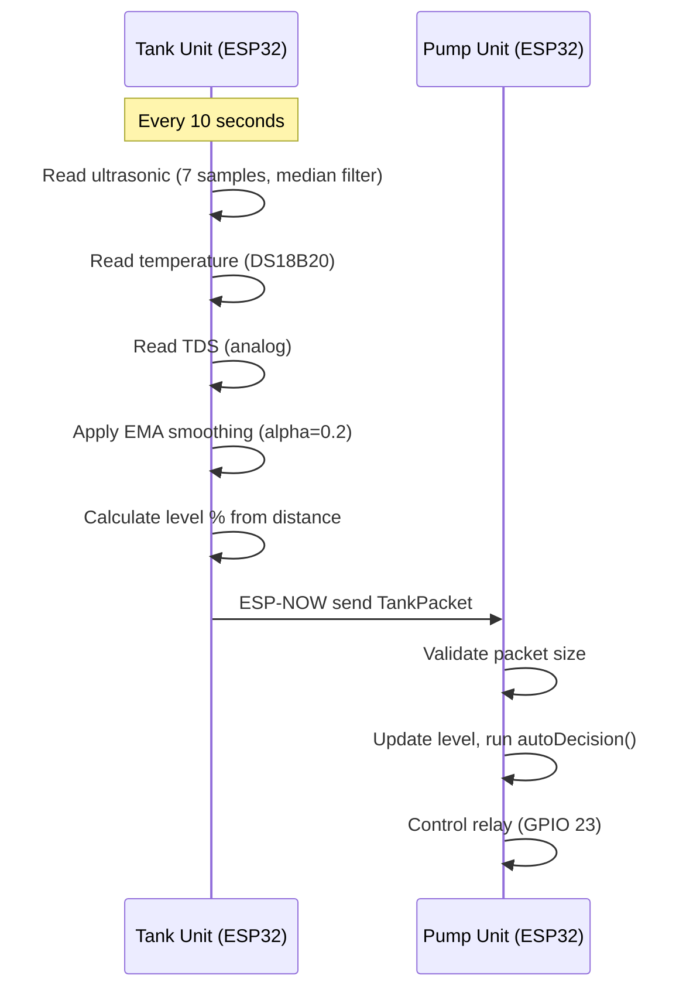

- **Protocol:** ESP-NOW (Espressif peer-to-peer, no router needed)
- **Range:** ~200m line of sight
- **Packet Size:** ~12 bytes (TankPacket struct)
- **Peer MAC Address:** Hardcoded in Tank Unit config

### 5.2 MQTT (Device-to-Cloud)

The Pump Unit connects to HiveMQ Cloud over WiFi to bridge sensor data to the web application.

- **Broker:** `c54cee0865234335a45b7af73963eef8.s1.eu.hivemq.cloud`
- **Port:** 8884 (WSS - WebSocket Secure)
- **Protocol:** MQTT over WebSocket with TLS
- **Reconnect Period:** 5,000 ms

### 5.3 MQTT Topic Map

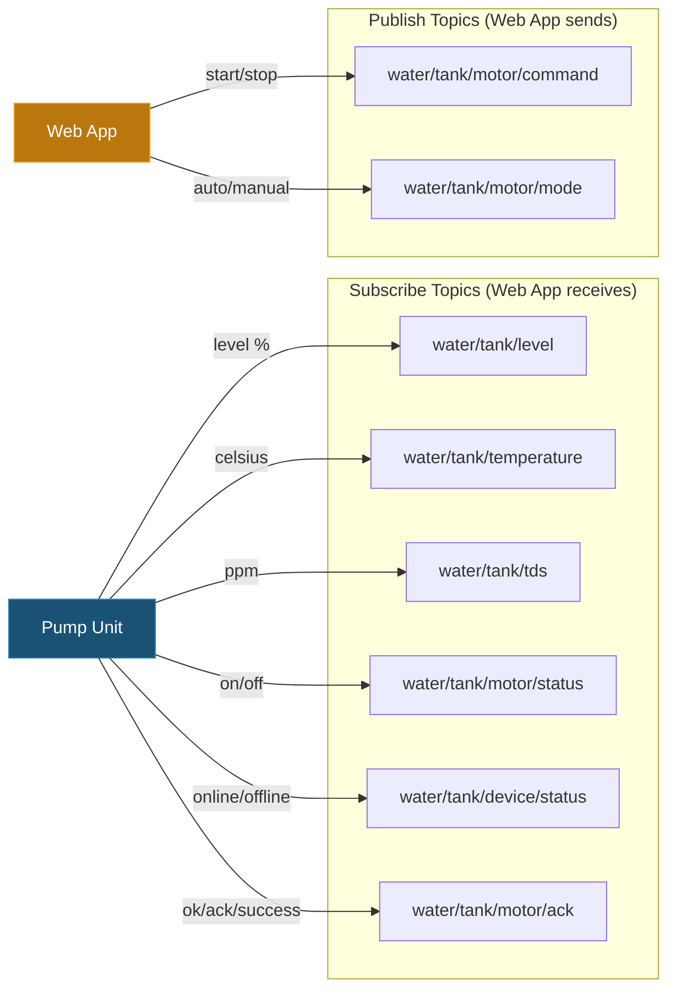

**Topic Details:**

| Topic | Direction | Payload | Description |
|-------|-----------|---------|-------------|
| `water/tank/level` | Device -> App | `0-100` (number) | Water level percentage |
| `water/tank/temperature` | Device -> App | Float (Celsius) | Water temperature |
| `water/tank/tds` | Device -> App | Integer (ppm) | Salinity / TDS reading |
| `water/tank/motor/status` | Device -> App | `on`/`off`/`running`/`1`/`0` | Current motor state |
| `water/tank/device/status` | Device -> App | `online`/`offline`/`alive`/`1` | Heartbeat signal |
| `water/tank/motor/ack` | Device -> App | `ok`/`ack`/`success` | Command acknowledgment |
| `water/tank/motor/command` | App -> Device | `start`/`stop` | Motor start/stop command |
| `water/tank/motor/mode` | App -> Device | `auto`/`manual` | Operating mode change |

---

## 6. Cloud & Backend Layer

### 6.1 Supabase

Supabase provides authentication and the PostgreSQL database.

- **Project URL:** `https://ueeftkmequpcaujdvevx.supabase.co`
- **Features Used:** Auth (email/password, Google OAuth, OTP), PostgreSQL, Row-Level Security (RLS), Database Functions

**Database Tables:**

| Table | Purpose |
|-------|---------|
| `organizations` | Multi-tenant organization management |
| `profiles` | User profiles linked to auth.users |
| `invite_codes` | Organization invite codes for registration |

**Database Functions:**

| Function | Purpose |
|----------|---------|
| `use_invite_code(_code, _user_id)` | Validates invite code, increments usage, assigns user to org |
| `handle_new_user()` | Trigger: auto-creates profile on user signup |

### 6.2 HiveMQ Cloud

Managed MQTT broker for real-time IoT communication between ESP32 devices and the web application.

---

## 7. Frontend / Web Application

### 7.1 Technology Stack

| Technology | Version | Purpose |
|-----------|---------|---------|
| React | 18.3.x | UI framework |
| TypeScript | 5.8.x | Type safety |
| Vite | 5.4.x | Build tool & dev server |
| Tailwind CSS | 3.4.x | Utility-first styling |
| shadcn/ui | - | UI component library (Radix-based) |
| Framer Motion | 12.x | Animations |
| mqtt.js | 5.15.x | MQTT client (WebSocket) |
| @supabase/supabase-js | 2.99.x | Supabase client |
| React Router | 6.30.x | Client-side routing |
| TanStack React Query | 5.83.x | Server state management |
| Capacitor | 8.1.x | Native mobile app wrapper |
| Recharts | 2.15.x | Data visualization charts |
| Zod | 3.25.x | Schema validation |
| React Hook Form | 7.61.x | Form management |

### 7.2 Application Routes

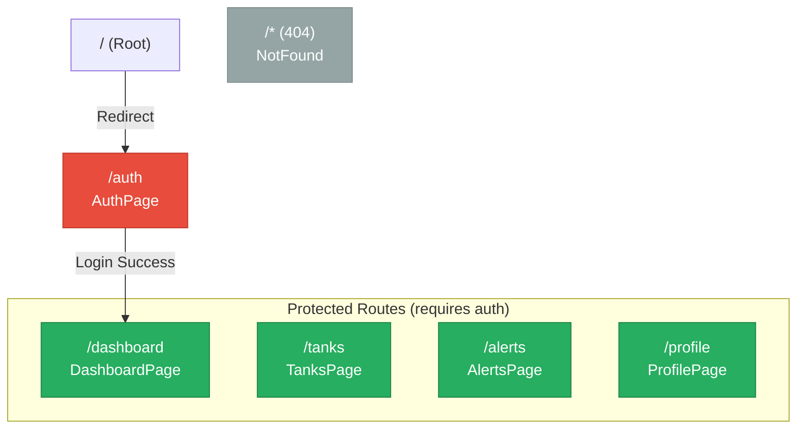

**Page Descriptions:**

| Page | Route | Description |
|------|-------|-------------|
| AuthPage | `/auth` | Login (email/password + Google OAuth), Registration (with invite code), OTP verification |
| DashboardPage | `/dashboard` | Real-time water level gauge, salinity & temperature cards, motor controls, recent logs |
| TanksPage | `/tanks` | Overview of all tanks (level, capacity, status, salinity, temperature) |
| AlertsPage | `/alerts` | Filterable alert feed (critical, warning, info, resolved) grouped by date |
| ProfilePage | `/profile` | User profile, company info, account settings, logout |
| NotFound | `/*` | 404 error page |

### 7.3 Component Architecture

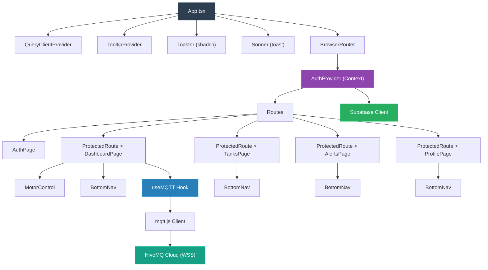

---

## 8. Data Flow Diagrams

### 8.1 Sensor Data Flow

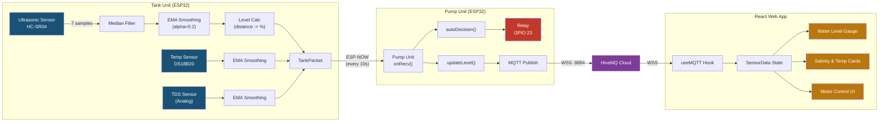

### 8.2 Motor Command Flow

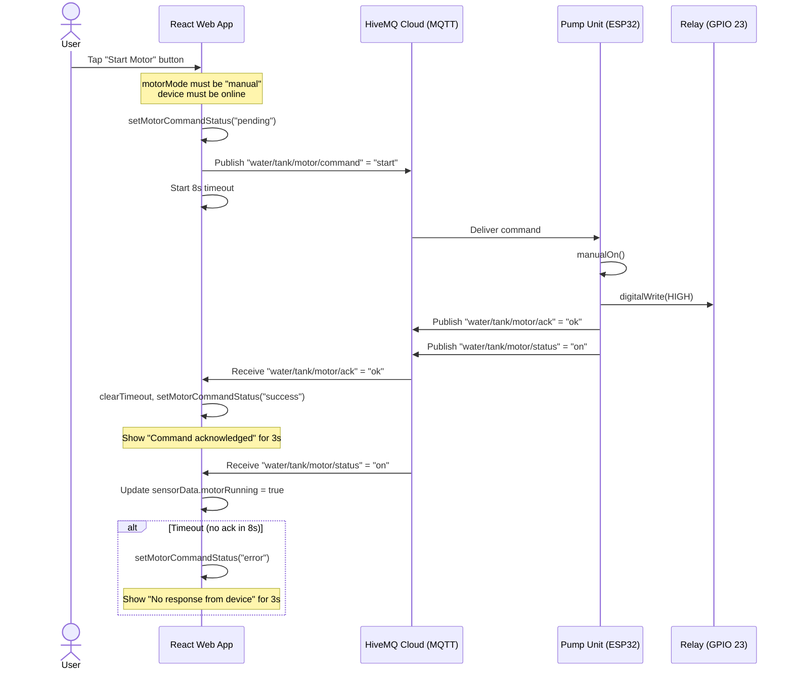

### 8.3 User Authentication Flow

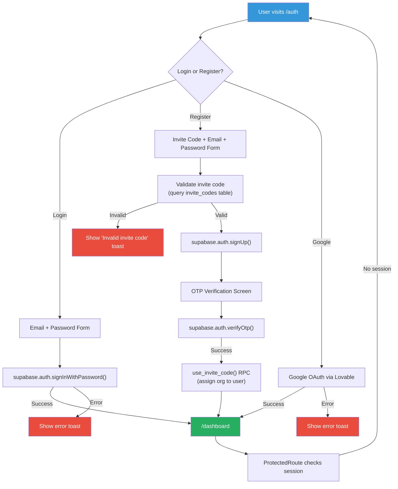

---

## 9. Database Schema

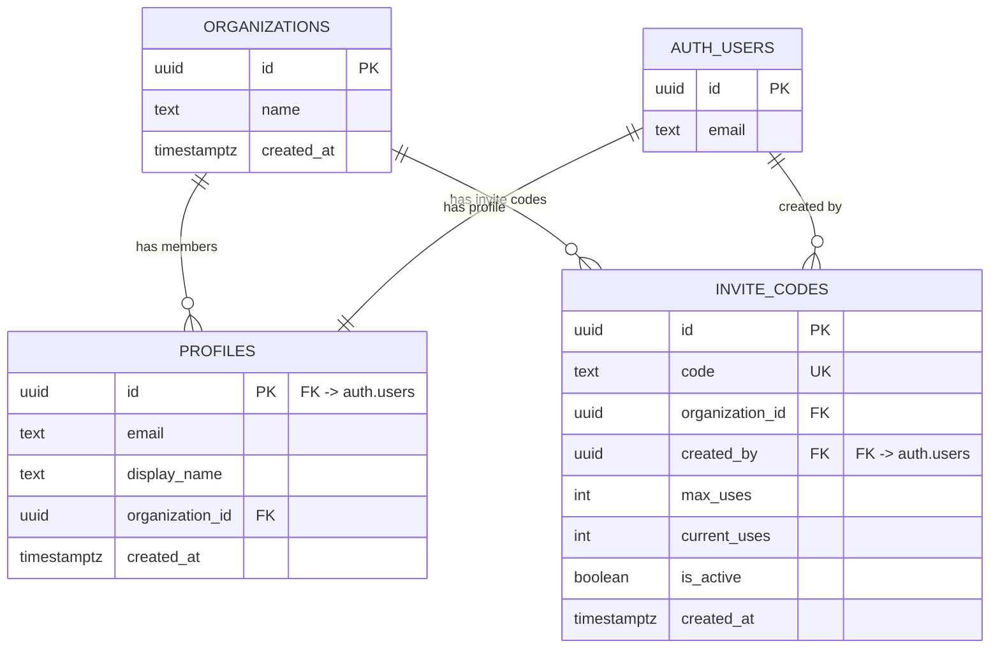

**Row-Level Security (RLS) Policies:**

| Table | Policy | Rule |
|-------|--------|------|
| `profiles` | Users can read own profile | `auth.uid() = id` |
| `profiles` | Users can update own profile | `auth.uid() = id` |
| `profiles` | Users can insert own profile | `auth.uid() = id` |
| `organizations` | Members can read their org | Profile must have matching `organization_id` |
| `invite_codes` | Authenticated can read active codes | `is_active = true` |
| `invite_codes` | Anon can read active codes | `is_active = true` (for signup validation) |

---

## 10. Deployment Architecture

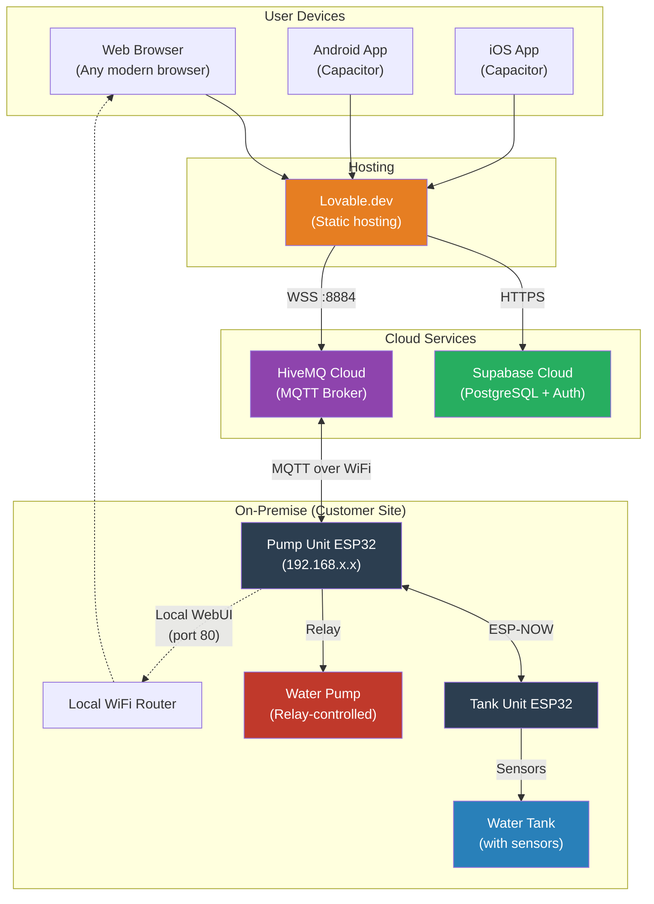

**Build & Deploy:**

| Component | Build Tool | Target |
|-----------|-----------|--------|
| Web App | Vite (`npm run build`) | Static files -> Lovable.dev |
| Android App | Capacitor + Gradle | APK/AAB |
| iOS App | Capacitor + Xcode | IPA |
| Tank Unit Firmware | PlatformIO (ESP32) | Flash via USB/OTA |
| Pump Unit Firmware | PlatformIO (ESP32) | Flash via USB/OTA |

---

## 11. Security Considerations

| Area | Implementation |
|------|---------------|
| **Authentication** | Supabase Auth (email/password, Google OAuth, OTP) |
| **Authorization** | Row-Level Security (RLS) on all database tables |
| **Invite System** | Organization invite codes with usage limits and deactivation |
| **MQTT Transport** | TLS/SSL via WSS (port 8884) |
| **Database Functions** | `SECURITY DEFINER` for sensitive operations (invite code usage) |
| **Session Management** | Supabase handles JWT tokens, auto-refresh, localStorage persistence |
| **Protected Routes** | React `ProtectedRoute` component checks session before rendering |

---

## 12. Component Interaction Diagram

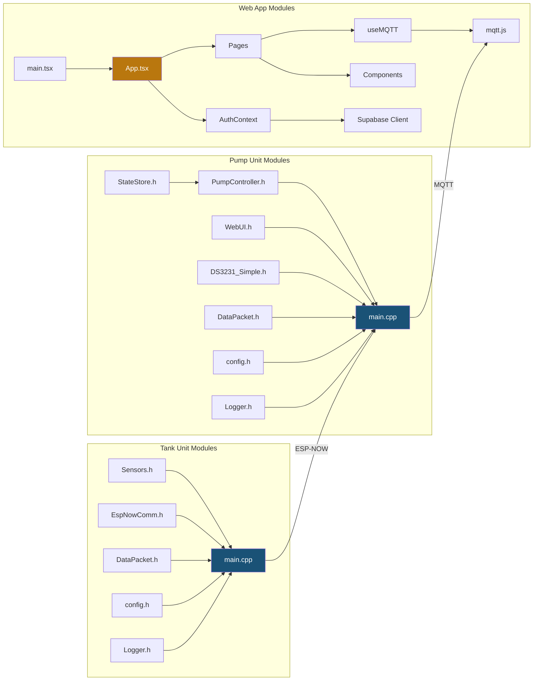

---

## 13. State Machine Diagrams

### 13.1 Pump Controller State Machine

```mermaid
stateDiagram-v2
    [*] --> OFF : Boot (forceOff)

    state "AUTO Mode" as AUTO {
        OFF --> ON : level <= lowLimit
        ON --> OFF : level >= highLimit
    }

    state "MANUAL Mode" as MANUAL {
        OFF --> ON : manualOn() / MQTT "start"
        ON --> OFF : manualOff() / MQTT "stop"
    }

    state "TIMER Mode" as TIMER {
        OFF --> ON : Current time in window
        ON --> OFF : Current time outside window
    }

    state "Safety Overrides" as SAFETY {
        ON --> OFF : No data > 10s
        ON --> OFF : Run time > 1 hour
    }

    note right of AUTO
        Default mode.
        Thresholds configurable
        via WebUI (25%-80% default).
    end note
```

### 13.2 MQTT Connection State Machine

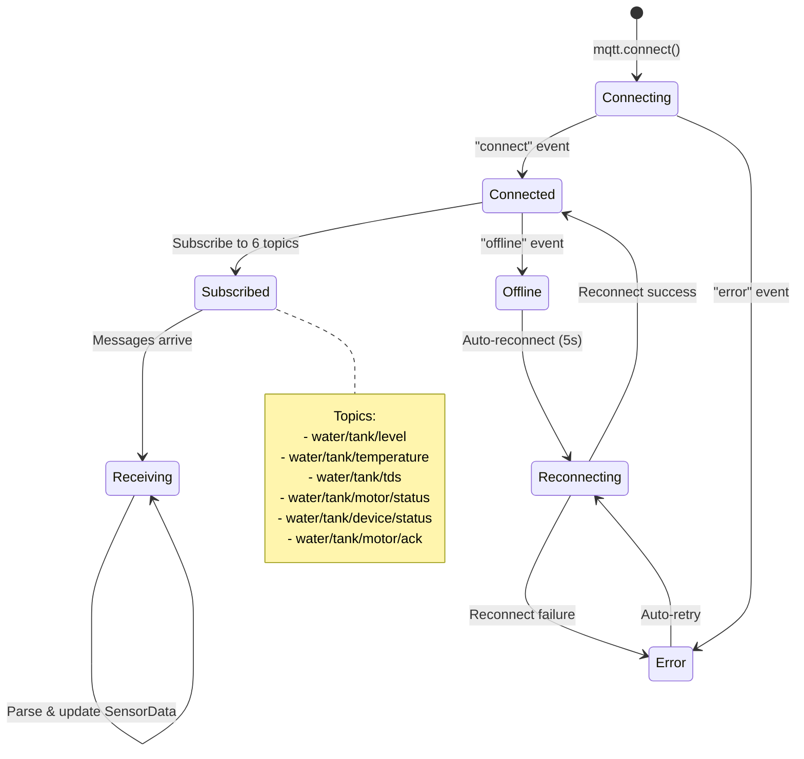

### 13.3 Motor Command State Machine

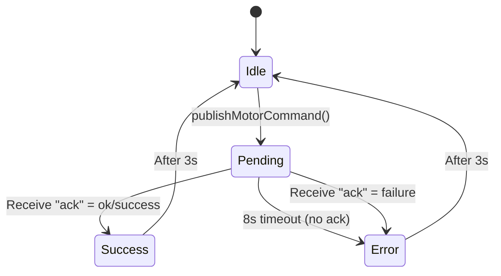

---

## Repository Structure

```
cuvoto-web-spark/           # Web Application (this repo)
├── src/
│   ├── App.tsx             # Root component with routing
│   ├── main.tsx            # Entry point
│   ├── components/
│   │   ├── BottomNav.tsx   # Bottom navigation bar
│   │   ├── NavLink.tsx     # Navigation link component
│   │   ├── ProtectedRoute.tsx  # Auth guard wrapper
│   │   ├── dashboard/
│   │   │   └── MotorControl.tsx  # Motor control panel
│   │   └── ui/             # shadcn/ui components
│   ├── contexts/
│   │   └── AuthContext.tsx  # Supabase auth context provider
│   ├── hooks/
│   │   ├── useMQTT.ts      # MQTT connection & sensor data hook
│   │   ├── use-mobile.tsx   # Mobile detection hook
│   │   └── use-toast.ts    # Toast notification hook
│   ├── integrations/
│   │   ├── supabase/
│   │   │   ├── client.ts   # Supabase client init
│   │   │   └── types.ts    # Auto-generated DB types
│   │   └── lovable/
│   │       └── index.ts    # Lovable cloud auth integration
│   └── pages/
│       ├── AuthPage.tsx    # Login / Register / OTP
│       ├── DashboardPage.tsx  # Main dashboard with gauge
│       ├── TanksPage.tsx   # All tanks overview
│       ├── AlertsPage.tsx  # Alerts & notifications
│       ├── ProfilePage.tsx # User profile & settings
│       └── NotFound.tsx    # 404 page
├── supabase/
│   └── migrations/         # SQL migration files
├── public/                 # Static assets
├── capacitor.config.json   # Mobile app config
├── tailwind.config.ts      # Tailwind CSS configuration
├── vite.config.ts          # Vite build configuration
└── package.json            # Dependencies & scripts

water-system/               # Hardware Firmware (separate repo)
└── cuvoto_tank/
    ├── tank-unit/          # Sensor node firmware
    │   ├── src/main.cpp
    │   ├── include/
    │   │   ├── config.h       # Pin definitions & constants
    │   │   ├── Sensors.h      # Ultrasonic, temp, TDS drivers
    │   │   ├── EspNowComm.h   # ESP-NOW sender
    │   │   ├── DataPacket.h   # Packet structure
    │   │   └── Logger.h       # Debug logging
    │   └── platformio.ini
    ├── pump-unit/          # Controller node firmware
    │   ├── src/main.cpp
    │   ├── include/
    │   │   ├── config.h       # Pin definitions, modes, safety
    │   │   ├── PumpController.h  # Pump logic (auto/manual/timer)
    │   │   ├── StateStore.h   # NVS persistence
    │   │   ├── WebUI.h        # Local web interface
    │   │   ├── DS3231_Simple.h  # RTC for timer mode
    │   │   ├── DataPacket.h   # Packet structure
    │   │   └── Logger.h       # Debug logging
    │   └── platformio.ini
    └── pump-simulator/     # Development simulator
        ├── src/
        │   ├── main.cpp
        │   ├── PumpController.h
        │   ├── PumpController.cpp
        │   └── WebUI.h
        └── platformio.ini
```
